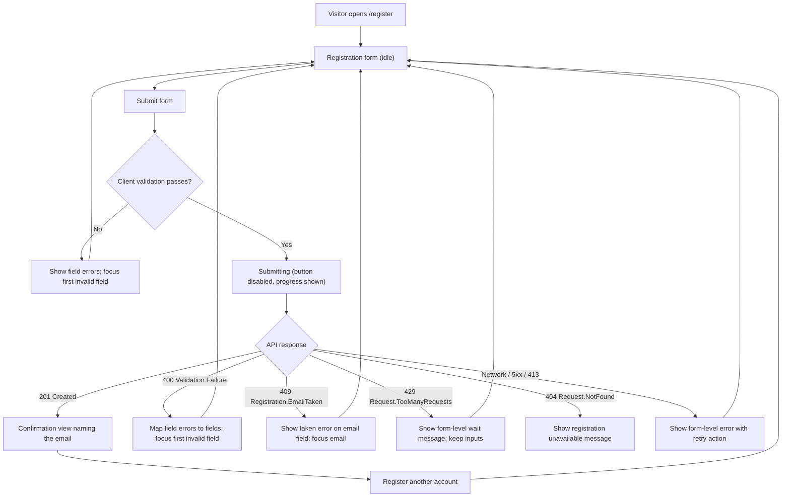

# 0001 User registration — Design proposal

Spec: `../Shipwise/docs/specs/0001-user-registration.md` (draft) · Design tokens: `DESIGN.md`

## Flow

- **Entry:** Direct navigation to `/register` (public route; no authentication required). No existing page links to `/register` in this spec because sign-in (spec 0002) is out of scope.
- **Exit:** After `201 Created`, the visitor remains on `/register` in a confirmation state that names the registered email and does not sign them in (AC-7, AC-10). They can choose **Register another account** to reset the form.

## Screens

### Registration (`/register`)

- **Route:** `/register` (public, outside `AppLayout`).
  - **Shell decision:** Sits outside `AppLayout` in a minimal public page shell (skip-to-content link, compact top bar with the Shipwise wordmark matching `AppLayout`, and `<main id="main-content" tabIndex={-1}>`). Showing the workspace sidebar (`Organizations`, `Projects`, `Sprint planning`, `Settings`) and `My account` menu to an unauthenticated visitor would imply workspace access that does not exist yet.
- **Reused components (`src/components`):**
  - `PageContainer` (`src/components/layout/page.tsx`) for consistent max-width (`1152px`) and responsive gutters (`20px` mobile, `40px` desktop).
  - `Form`, `FormField`, `FormItem`, `FormLabel`, `FormControl`, `FormDescription`, `FormMessage` (`src/components/ui/form.tsx`) with `react-hook-form` + `zod` (`@hookform/resolvers/zod`), following `src/app/dev/form-example.tsx`.
  - `Input` (`src/components/ui/input.tsx`) for Email, Display name, and Password.
  - `Button` (`src/components/ui/button.tsx`) for primary submit (`size="default"`, `44px` height), password visibility toggle (`variant="ghost"`, `size="icon"`, `44px × 44px` touch target), and confirmation reset (`variant="secondary"`).
  - `LoadingIndicator` (`src/components/shared/loading-indicator.tsx`) as the route-level `Suspense` fallback in `router.tsx`.
- **New feature-local components (`src/features/auth/components`):**
  - `RegisterForm` (or `RegistrationCard`): bordered white card (`bg-card border rounded-lg` = `12px` radius, no shadow) containing the heading, form-level alert region, the three fields, and submit button, plus the confirmation state.
- **Layout by viewport:**
  - **375px (mobile):** Compact header (`h-18`, `px-5`). `PageContainer` applies `px-5 py-8`. Single-column card fills available width (`w-full`, `p-6`, thin `1px` `#E5E7EB` border). Stacked form fields (`space-y-5`). Primary submit button is full-width (`w-full`, `44px` height).
  - **768px (tablet):** `PageContainer` applies `px-10 py-10`. Card is horizontally centered (`mx-auto max-w-md`, `448px`), `p-8`, with generous whitespace on the `#FFFFFF` canvas. Primary submit button is `w-full` inside the `max-w-md` card.
  - **1440px (desktop):** Same centered `max-w-md` (`448px`) bordered card inside `PageContainer` (`max-w-6xl px-10 py-10`), vertically balanced below the header. Single-column form prevents wide-line fatigue.
- **Design token compliance:** Uses only existing `DESIGN.md` / `src/styles/globals.css` tokens (`#FFFFFF` background/card, `#17324D` foreground/primary button, `#E5E7EB` border/input, `#586575` muted helper text, `#B42318` destructive error text, `#276488` focus ring). No gradients, no `#DDF4FF` card fills, no card shadows.

## States

| State                                                    | What the user sees                                                                                                                                                                                                                                                                                                               | What the user can do                                                         |
| -------------------------------------------------------- | -------------------------------------------------------------------------------------------------------------------------------------------------------------------------------------------------------------------------------------------------------------------------------------------------------------------------------- | ---------------------------------------------------------------------------- |
| **Loading (route chunk)**                                | `LoadingIndicator` (`role="status"`, `"Loading page…"`).                                                                                                                                                                                                                                                                         | Wait for the lazy route chunk to load.                                       |
| **Idle (initial)**                                       | Card title (`"Create an account"`), brief subtitle, three labeled inputs (`Email`, `Display name`, `Password`) with persistent helper text (`"1–100 characters"` for display name, `"12–128 characters"` for password), password visibility toggle (`"Show password"`), and enabled primary button (`"Create account"`).         | Type into any field, toggle password visibility, or submit.                  |
| **Empty**                                                | Not applicable (no list or remote data is fetched before submission; the initial form is the idle state).                                                                                                                                                                                                                        | —                                                                            |
| **Client validation error**                              | Inline `FormMessage` under each invalid field (`email`, `displayName`, `password`) matching AC-3 rules; invalid inputs have `aria-invalid="true"` and destructive border.                                                                                                                                                        | Edit any field (field error clears on change or re-validation) and resubmit. |
| **Submitting / disabled**                                | Submit button is disabled (`disabled`), label changes to `"Creating account…"` with an inline status indicator; inputs remain readable (or disabled while in flight) and duplicate submission is blocked (AC-10).                                                                                                                | Wait for the request to complete.                                            |
| **Server field errors (`400 Validation.Failure`)**       | Each field returned in `error.errors` (`email`, `displayName`, `password`) shows a mapped frontend validation message under that field via `form.setError`. Raw server text is not shown (AC-8, AC-9).                                                                                                                           | Correct the highlighted fields and resubmit.                                 |
| **Email taken (`409 Registration.EmailTaken`)**          | Email field shows `"An account with this email already exists."` (AC-9) and receives focus. Password and display name values are preserved.                                                                                                                                                                                      | Change the email address and resubmit.                                       |
| **Rate limited (`429 Request.TooManyRequests`)**         | Form-level `role="alert"` banner above the submit button: `"Too many registration attempts. Please wait a moment and try again."` (incorporating `Retry-After` seconds if mapped by the data layer, without raw server text). Inputs are preserved.                                                                              | Wait, then resubmit.                                                         |
| **Registration unavailable (`404 Request.NotFound`)**    | Form-level `role="alert"` banner: `"Registration is currently unavailable. Contact your administrator if you need an account."` (covers AC-12 when `Registration:Enabled` is false).                                                                                                                                             | Navigate away or contact an administrator.                                   |
| **Request failure with retry (network / `5xx` / `413`)** | Form-level `role="alert"` banner: `"Unable to create your account right now. Please try again."` with a `"Try again"` action or re-enabled submit button (no raw server text).                                                                                                                                                   | Click `"Try again"` / resubmit without retyping fields.                      |
| **Success (`201 Created`)**                              | Form is replaced inside the card by a confirmation view (`role="status"`): heading `"Account created"`, body naming the submitted email (e.g., `"Your account for ana@example.com is ready. You have not been signed in."`), and a secondary `"Register another account"` button. No fake/nonfunctional sign-in button is shown. | Click `"Register another account"` to return to an empty idle form.          |
| **Permission denied**                                    | Not applicable (`POST /api/v1/auth/register` is public and requires no token or organization role).                                                                                                                                                                                                                              | —                                                                            |

## Data needed

### Sent (`POST /api/v1/auth/register`)

| Field         | UI control                                                                  | Client rules (matching AC-3)                          | Notes                                                                         |
| ------------- | --------------------------------------------------------------------------- | ----------------------------------------------------- | ----------------------------------------------------------------------------- |
| `email`       | Text input (`type="email"`, `autoComplete="email"`)                         | Required; trimmed; 3–254 chars; valid email format    | Trimmed before/on submit to match backend normalization.                      |
| `displayName` | Text input (`type="text"`, `autoComplete="name"`)                           | Required; trimmed; 1–100 chars; no control characters | Non-unique; displayed as entered (trimmed).                                   |
| `password`    | Password input (`type="password" \| "text"`, `autoComplete="new-password"`) | Required; 12–128 chars; **never trimmed**             | Sent verbatim; never logged or persisted in client state after unmount/reset. |

### Received & actions triggered

- **Action:** `useRegisterMutation` (in `src/features/auth/api`, owned by Codex in Task 2) sends `{ email, displayName, password }` to `POST /api/v1/auth/register`.
- **201 response:** `{ data: { userId: string } }` — confirms creation; UI displays the submitted email from local form state (never exposes `userId` unless needed, and does not store any token/session).
- **Error mapping (AC-8):** Data layer maps `400 Validation.Failure` (`error.errors` keyed by `email`, `displayName`, `password`), `404 Request.NotFound`, `409 Registration.EmailTaken`, `429 Request.TooManyRequests` (`Retry-After` header), and unexpected/network errors into typed results without exposing raw server strings.
- **Contract gaps:** None identified against the draft spec's API contract section (`Shipwise/docs/specs/0001-user-registration.md`).

## Accessibility

- **Keyboard order:**
  1. `"Skip to content"` link (jumps to `#main-content`)
  2. Shipwise header brand (if linked)
  3. `Email` input
  4. `Display name` input
  5. `Password` input
  6. `"Show password"` / `"Hide password"` toggle button (`44px × 44px` hit area, `aria-pressed`)
  7. `"Create account"` submit button (`44px` height)
  - In confirmation state: `"Register another account"` button.
- **Labels and descriptions:**
  - Every input uses `FormLabel` (persistent visible `<label>`) and `FormDescription` / `FormMessage` linked via `aria-describedby` (provided by `src/components/ui/form.tsx`).
  - Password visibility toggle uses `type="button"` (never submits the form) and updates `aria-label` (`"Show password"` / `"Hide password"`) and `aria-pressed`.
- **Focus management (AC-11):**
  - On client validation failure or `400` server field errors, focus moves to the first invalid field (`react-hook-form` `setFocus` / native `shouldFocusError`).
  - On `409 Registration.EmailTaken`, focus moves to the `Email` input.
  - On `201 Created`, focus moves to the confirmation heading (`tabIndex={-1}`) or status container so screen readers announce the outcome immediately.
  - On `"Register another account"`, focus moves to the `Email` input.
- **Live announcements:**
  - Field errors render inside `FormMessage` (`aria-invalid` on input + linked `aria-describedby`).
  - Form-level failures (`429`, `404`, network/`5xx`) render in a `role="alert"` container.
  - Submitting progress and success confirmation use `role="status"` (`aria-live="polite"`).
  - Status is never communicated by color alone (text + `role="alert"` / `role="status"` + `aria-invalid`).

## Open questions and simplifications

- **No open blockers.** Spec 0001 already resolved password rules, 409 behavior, registration switch (404), and post-registration behavior.
- **Simplification — Password visibility toggle:** Included as a single icon button (`44px × 44px`) inside the password field row. Because `src/components/ui/input.tsx` defaults to `h-9` (`36px`), the password input container should use `h-11` (`44px`) or align the `size="icon"` (`44px`) button cleanly without altering `src/components/ui/input.tsx` globally.
- **Simplification — No password strength meter:** Spec 0001 only requires 12–128 characters. Showing `"Use 12–128 characters."` as helper text avoids inventing unrequested complexity rules or strength meters.
- **Note for Task 2 (`router.tsx`):** Confirm `/register` is registered outside `AppLayout` so unauthenticated visitors do not see the workspace sidebar or `My account` dropdown.
